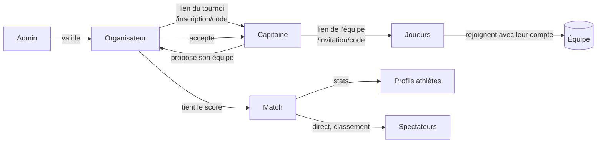

# Userflows

Un fichier par parcours précis. Chaque parcours donne : l'acteur, le point de départ, les étapes, le résultat attendu, les cas d'erreur, et un schéma (Mermaid, affiché par GitHub et VS Code).

| Parcours | Acteur | En bref |
|---|---|---|
| [admin-flow](admin-flow.md) | Administrateur THE LAB | Valider un organisateur, fusionner des doublons, corriger |
| [organisateur-flow](organisateur-flow.md) | Organisateur | Du compte au tournoi terminé |
| [capitaine-flow](capitaine-flow.md) | Capitaine | Inscrire son équipe par le lien du tournoi |
| [joueur-flow](joueur-flow.md) | Joueur | Rejoindre son équipe par le lien d'invitation, voir son profil |
| [marqueur-flow](marqueur-flow.md) | Marqueur | Tenir un match en direct ou saisir la feuille après coup |
| [spectateur-flow](spectateur-flow.md) | Spectateur | Suivre un tournoi sans compte |

## Vue d'ensemble : qui envoie quoi à qui

