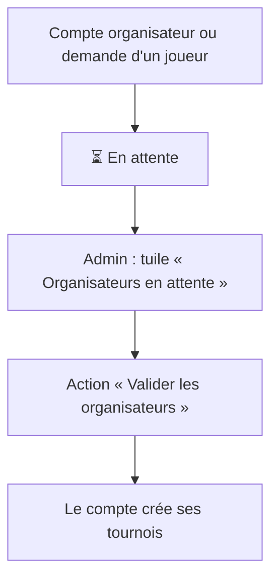

# Admin flow

**Acteur** : administrateur THE LAB (superuser Django).
**Outil** : l'admin Django (`/admin/`), aux couleurs de THE LAB.

## 1. Valider un organisateur

**Déclencheur** : un compte créé en mode organisateur, ou un joueur qui a demandé à organiser. L'accueil de l'admin affiche la tuile « ⏳ Organisateurs en attente » en orange.

1. L'admin clique sur la tuile : **Utilisateurs** filtrés sur « En attente de validation ».
2. Il vérifie le pseudo et l'email.
3. Il coche le compte puis lance l'action **« Valider comme organisateur »**.
4. La colonne « Type de compte » passe de « ⏳ En attente » à « ✅ Organisateur ».

**Résultat** : le compte peut créer jusqu'à 3 tournois actifs.
**Inverse** : action « Retirer la validation ».

## 2. Fusionner deux fiches athlètes

**Déclencheur** : la même personne a deux fiches (saisie à la main sans email, puis inscrite par lien).

1. **Athlètes** → cocher les deux fiches → action de fusion.
2. La fiche reliée à un compte est gardée en priorité ; les joueurs de l'autre fiche y sont rattachés ; l'email de la fiche absorbée est recopié s'il manque.

**Refusé si** : les deux fiches sont reliées à deux comptes différents, ou si la fusion mettrait la personne deux fois dans le même tournoi.

## 3. Consulter les demandes d'équipes

**Où** : **Demandes d'équipes** (filtre par statut : en attente, acceptée, refusée).
**Usage** : support, quand un capitaine dit « mon équipe n'apparaît pas ». La décision reste à l'organisateur du tournoi.

## 4. Corriger une donnée

L'admin peut modifier tournois, équipes, joueurs, matchs et statistiques. Le règlement d'un tournoi ou d'un match s'affiche en clair (« Règlement (lisible) »).
⚠️ Changer à la main la fiche d'un joueur ne vérifie pas la règle « un athlète par tournoi ».

## 5. Rouvrir un match terminé

**Matchs** → filtre « Terminé » → cocher → action **« Rouvrir les matchs terminés »**. Le match repasse « en cours ».
**Refusé si** : la phase suivante a déjà commencé (même règle que l'appli) ; le message dit quoi réinitialiser.

## Tableau de bord

L'accueil de l'admin montre : organisateurs en attente et équipes proposées en attente (en orange s'il y en a), matchs en cours, tournois en cours ou à venir, comptes, fiches athlètes. Chaque tuile ouvre la liste filtrée.

## Prévu

- ⏳ 6.3 : mode support, pour modifier un tournoi depuis le site avec un bandeau et une trace.
