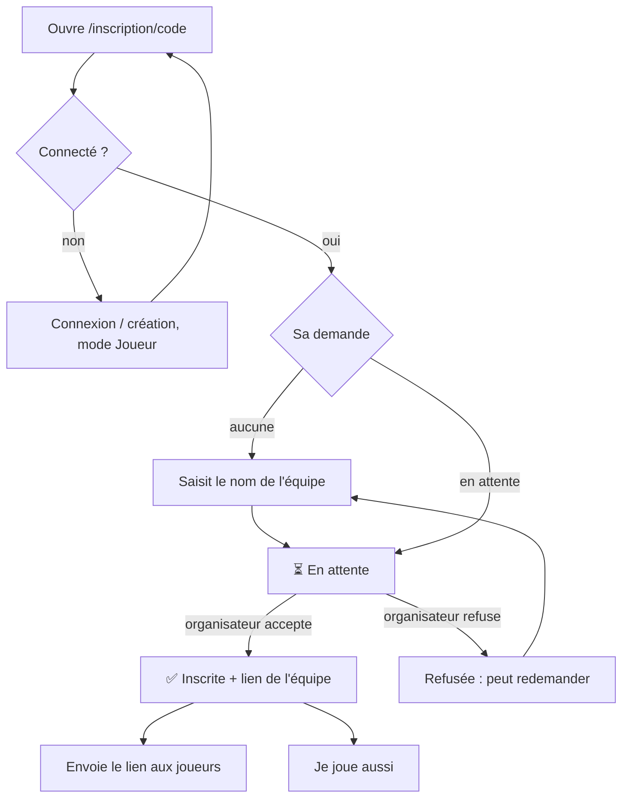

# Capitaine flow

**Acteur** : capitaine d'une équipe.
**Point de départ** : il reçoit le lien du tournoi `/inscription/<code>` (WhatsApp, email…).

## Étapes

1. Il ouvre le lien : nom du tournoi, date, organisateur, nombre d'équipes inscrites sur le maximum.
2. **Pas connecté** → « Se connecter » ou « Créer mon compte ». La page s'ouvre en mode **🏀 Joueur** (blanc et orange) et le ramène sur le lien après la connexion.
3. Il saisit le **nom de son équipe** → « Envoyer la demande ».
4. Écran **⏳ en attente de validation**. Tant que c'est en attente, il peut corriger le nom.
5. L'organisateur accepte → en revenant sur le même lien : **✅ inscrite**, avec :
   - le **lien de l'équipe** à copier et envoyer à ses joueurs ;
   - le bouton **« Je joue aussi »**, qui l'amène sur la page de l'équipe pour s'y ajouter (voir [joueur-flow](joueur-flow.md)).

## Règles

- Une seule demande par compte et par tournoi.
- Le nom ne doit pas exister déjà dans le tournoi (majuscules ignorées), ni être en attente pour une autre équipe.
- Refusé si le tournoi est complet, clôturé, ou si les inscriptions sont fermées.
- Le lien marche aussi pour un tournoi privé, sans donner accès à sa page.
- Si l'organisateur supprime l'équipe plus tard, le capitaine peut refaire une demande.
- Le capitaine n'est pas automatiquement joueur : il s'ajoute avec « Je joue aussi ».

## Messages d'erreur

| Situation | Message |
|---|---|
| Nom vide | « Indique le nom de ton équipe. » |
| Nom déjà pris | « Une équipe s'appelle déjà « X » dans ce tournoi. » |
| Déjà inscrit | « Ton équipe est déjà inscrite dans ce tournoi. » |
| Inscriptions fermées ou tournoi clôturé | « Les inscriptions de ce tournoi sont fermées. Contacte l'organisateur. » |
| Tournoi complet | « Le tournoi est complet (32 équipes maximum). » |
| Lien remplacé ou désactivé | Page « Lien invalide » |

## Prévu

- Email au capitaine quand son équipe est acceptée (après 4.2).
- Question ouverte : le capitaine peut-il gérer son effectif seul ?
