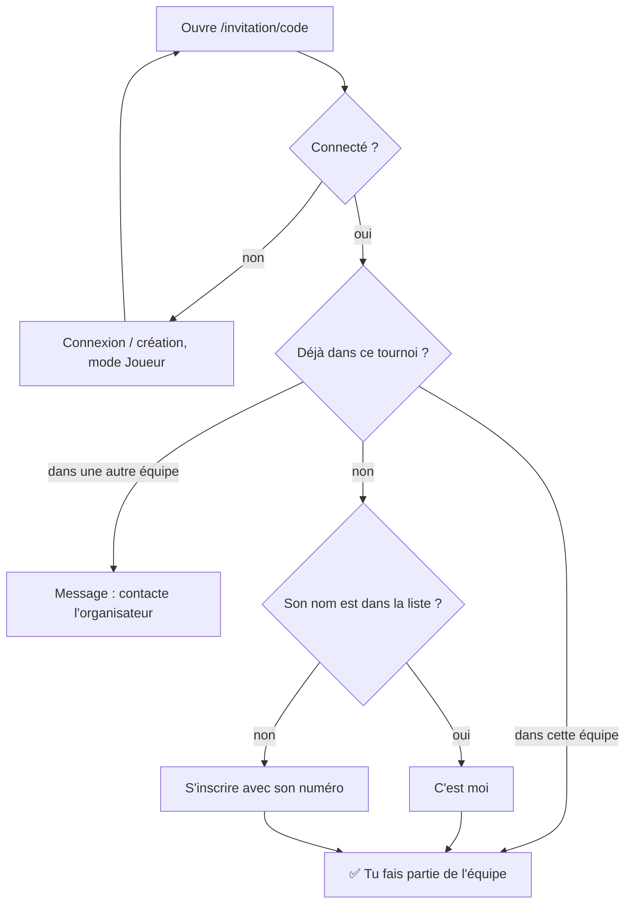

# Joueur flow

**Acteur** : joueur.
**Point de départ** : il reçoit le lien de son équipe `/invitation/<code>` (par son capitaine).

## 1. Rejoindre son équipe

1. Il ouvre le lien : logo et nom de l'équipe, tournoi, effectif actuel.
2. **Pas connecté** → connexion ou création de compte en mode **🏀 Joueur**, retour automatique sur le lien. L'email est obligatoire.
3. Trois cas :

| Cas | Ce qu'il voit | Action |
|---|---|---|
| L'organisateur l'a déjà saisi avec le même nom que sa fiche | « C'est toi ? #7 Paul Martin » | « C'est moi » → confirmation |
| Il est dans la liste sous un autre nom | « Déjà dans la liste ? » | Choisit son nom → « C'est moi » |
| Il n'est pas dans la liste | « Rejoindre l'équipe » | Numéro (0 à 99), plus prénom et nom la première fois |

4. Résultat : **✅ Tu fais partie de l'équipe (#7)** et « Voir mon profil ». Son joueur porte le badge ✓ (compte relié).

## Règles

- Une seule fiche athlète par personne : elle le suit dans tous ses tournois.
- Un seul joueur par tournoi pour une même personne.
- Un joueur déjà relié à un autre compte ne peut pas être réclamé.
- S'inscrire avec un numéro demande des inscriptions ouvertes ; « C'est moi » marche même quand elles sont fermées.
- Le numéro doit être libre dans l'équipe ; 25 joueurs maximum par équipe.

## 2. Consulter son profil

1. **👤 pseudo · Mon profil** dans la barre du haut → `/mon-profil`, qui ouvre `/athlete/<id>`.
   - Compte pas encore relié : page qui explique de rejoindre son équipe avec le lien d'invitation (aucune fiche créée), et bouton « Demander un compte organisateur ».
2. Il voit : badge **✓ Compte vérifié**, cumul et moyennes de carrière (matchs terminés), titres de MVP, titres, et pour chaque tournoi : équipe, numéro, moyennes, résultat.
3. Le profil est public, l'email n'y apparaît jamais.
4. Sur **son** profil : « Ajouter une photo », « Changer », « Retirer ». La photo est compressée dans le navigateur (800 px, WebP) avant l'envoi ; elle apparaît aussi sur les écrans de match quand l'organisateur n'en a pas mis.

## Prévu

- Liaison automatique par email quand les emails seront vérifiés (4.2).
- Mot de passe oublié (4.2).
- Suppression du compte, autorisation parentale pour les mineurs (6.4).
