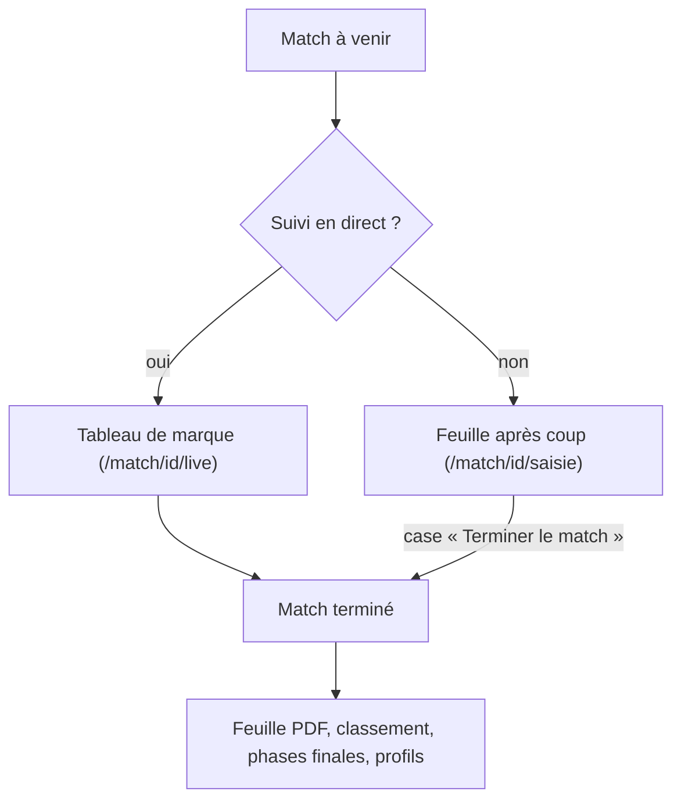

# Marqueur flow

**Acteur** : la personne à la table de marque (le compte de l'organisateur).
**Point de départ** : un match du calendrier.

Deux façons de saisir un match :

## A. Tableau de marque en direct

1. Page du match → **Live**. Les stats des joueurs sont initialisées.
2. Pendant le match :
   - **chrono** démarré et arrêté par le marqueur, calculé par le serveur (pas de dérive entre appareils) ;
   - **shot clock** (désactivable dans le règlement) ;
   - pour chaque joueur : points (1, 2, 3), rebonds, passes, interceptions, contres, balles perdues, **fautes** ;
   - **fautes d'équipe** et **bonus** par segment ; **temps morts** selon le règlement ;
   - **période suivante**, puis **prolongations** en cas d'égalité ;
   - un joueur atteint la limite de fautes → **exclu**.
3. Erreur de saisie → **« Annuler la dernière action »**.
4. Le règlement de ce match peut être ajusté (⚙️).
5. Fin du match → **terminé**, stats et score figés. En phase finale, la série avance toute seule.
6. **Présences** : un pop-up liste, par équipe, les joueurs à 0 partout. Personne n'est pré-coché : le marqueur coche ceux qui sont entrés sur le terrain. S'il ferme le pop-up, ils comptent comme n'ayant pas joué.

**Écran de salle** : `/match/<id>/ecran`, plein écran, à afficher sur un grand écran pendant le direct.

## B. Saisie de la feuille après coup

**Quand** : le match n'a pas été suivi en direct (papier, réseau absent).

1. Page du match → **Saisir la feuille** (organisateur, match non terminé).
2. Pour chaque joueur, ses **totaux** du match.
3. **Score par période** facultatif (prolongations comprises).
4. Case **« Terminer le match »** pour le clore, puis le même pop-up de présences.

**Effets** : les actions du direct éventuelles sont annulées ; le score par période est effacé si les stats changent ensuite.

## Après le match

- **Feuille de match** `/match/<id>/feuille` : imprimable ou en PDF.
- Le classement, le MVP et les profils athlètes se mettent à jour.
- Bouton **Présences** : corrige qui a joué, sans rouvrir le match.

## Forfait

Page du match → **Forfait**, sur un match à venir ou en cours : équipe fautive, ou double forfait en poule, puis score (20-0 par défaut). Le match s'affiche « Forfait », sans feuille de stats. Les stats déjà saisies sont gardées mais ignorées ; elles reviennent si le forfait est annulé.

## Règles

- Seul l'organisateur du tournoi peut saisir.
- Pas de match nul.
- La première stat passe le match « en cours ».
- Deux saisies au même moment ne s'écrasent pas.
- Seuls les joueurs présents comptent dans les moyennes : au moins une stat, ou présence confirmée.
- Tournoi clôturé : plus aucune saisie.
- Rouvrir un match terminé se fait depuis l'admin (voir [admin-flow](admin-flow.md)).
