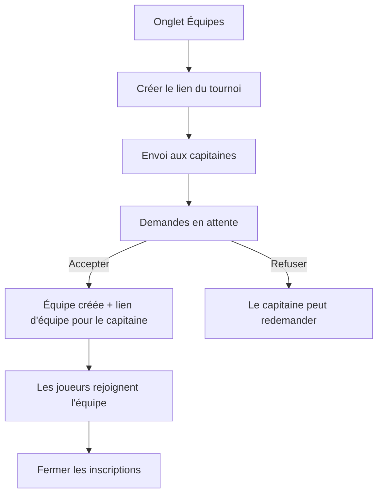

# Organisateur flow

**Acteur** : organisateur de tournoi.
**Point de départ** : la page d'accueil, sans compte.

## 1. Créer son compte

1. **Créer un compte**, interrupteur sur **📋 Organisateur** (thème sombre).
2. Pseudo, email, mot de passe → connecté directement.
3. Attendre la validation de l'admin (voir [admin-flow](admin-flow.md)) : une ligne fine « ⏳ Compte organisateur en attente de validation » sur l'accueil.
4. Déjà inscrit comme joueur ? « + Créer un Tournoi » propose **Demander un compte organisateur**.

## 2. Créer le tournoi

1. Accueil → **+ Créer un Tournoi**.
2. Nom (unique parmi ses tournois), dates, phases finales (consécutives : quarts + demis + finale, pas quarts + finale), règlement (FIBA, NBA, 3x3 ou personnalisé).
3. Le tournoi a ses onglets : **Classement · Calendrier · Équipes · Phase Finale · Paramètres**.

**Refusé si** : 3 tournois actifs déjà, nom déjà utilisé, date de fin avant la date de début, phases non consécutives.

## 3. Remplir les équipes

Trois façons, combinables :

| Façon | Étapes | Quand |
|---|---|---|
| **Lien du tournoi** (5.4) | Équipes → « Créer le lien » → copier → envoyer aux capitaines → accepter les demandes | Beaucoup d'équipes |
| **Lien de l'équipe** (5.3) | Créer l'équipe → « Lien d'invitation des joueurs » → envoyer au capitaine | L'équipe existe déjà |
| **À la main** | « Nouvelle équipe » puis « 👤+ » pour chaque joueur | Petit tournoi, joueurs sans compte |

**Gérer les inscriptions** :
- « Fermer les inscriptions » : plus de nouvelle équipe ni de nouveau joueur par lien ; les joueurs déjà saisis peuvent encore relier leur compte.
- « Nouveau lien » : l'ancien lien ne marche plus. « Désactiver » : plus de lien du tournoi.
- « ⛓ Délier » : détache un compte relié par erreur, le joueur reste dans l'équipe.

## 4. Organiser les matchs

1. **Calendrier** → créer les matchs de poule (deux équipes, date et heure de Paris).
2. Chaque match se joue en direct ou se saisit après coup (voir [marqueur-flow](marqueur-flow.md)).
3. **Classement** se met à jour tout seul (règles FIBA).

## 5. Phases finales

1. **Phase Finale** → **Générer** : le premier tour est créé à partir du classement.
2. Chaque série se joue au meilleur de N (réglé dans les Paramètres).
3. Quand une série est gagnée, le tour suivant se crée tout seul, jusqu'à la finale.
4. **Réinitialiser** (Paramètres) : supprime les matchs de la phase choisie et des suivantes.

## 6. Après le tournoi

- Le champion, le MVP et les stats restent publics.
- Chaque joueur garde ses stats sur son profil athlète.
- Le tournoi libère sa place (3 actifs) après sa date de fin.
