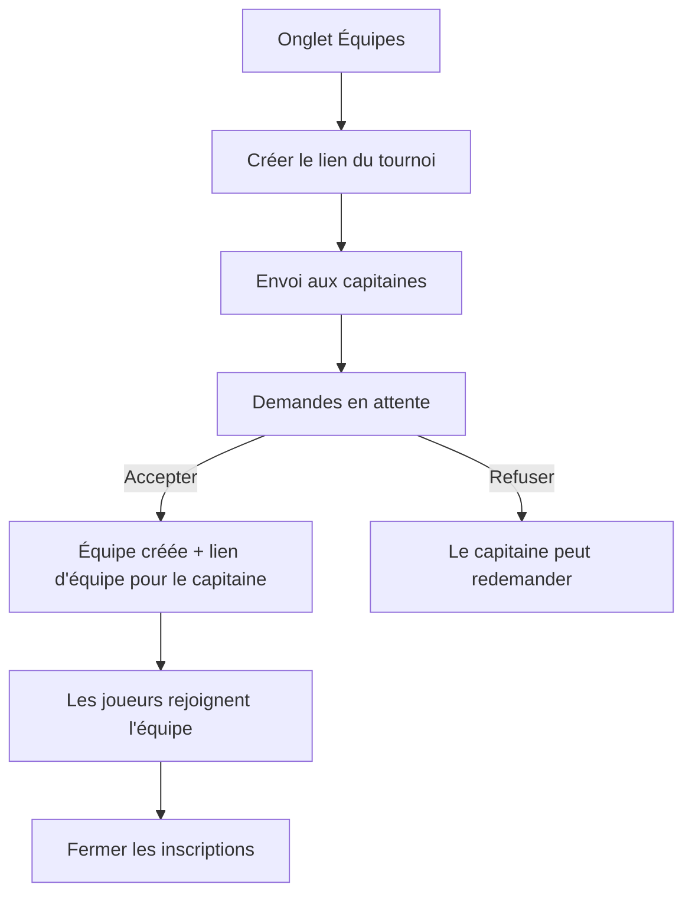

# Organisateur flow

**Acteur** : organisateur de tournoi.
**Point de départ** : la page d'accueil, sans compte.

## 1. Créer son compte

1. **Créer un compte**, interrupteur sur **📋 Organisateur** (thème sombre).
2. Pseudo, email, mot de passe → connecté directement.
3. Attendre la validation de l'admin (voir [admin-flow](admin-flow.md)) : une ligne fine « ⏳ Compte organisateur en attente de validation » sur l'accueil.
4. Déjà inscrit comme joueur ? « + Créer un Tournoi » propose **Demander un compte organisateur**.

## 2. Créer le tournoi

1. Accueil → **+ Créer un Tournoi**.
2. Nom (unique parmi ses tournois), dates, phases finales (consécutives : quarts + demis + finale, pas quarts + finale), règlement (FIBA, NBA, 3x3 ou personnalisé).
3. Il choisit **Public** ou **Privé**. Le choix se change ensuite avec l'interrupteur de la carte, que lui seul voit.
4. Le tournoi a ses onglets : **Classement · Calendrier · Équipes · Phase Finale · Paramètres**.

**Tournoi privé** : seuls l'organisateur et le staff le voient. Les liens d'inscription et d'invitation restent actifs, sans ouvrir sa page. Il compte dans la limite de tournois actifs, et ses stats sortent des profils joueurs tant qu'il reste privé. Une confirmation est demandée avant de passer en privé si le tournoi a déjà des équipes ou des matchs.

**Refusé si** : 3 tournois actifs déjà, nom déjà utilisé, date de fin avant la date de début, phases non consécutives.

## 3. Remplir les équipes

Trois façons, combinables :

| Façon | Étapes | Quand |
|---|---|---|
| **Lien du tournoi** (5.4) | Équipes → « Créer le lien » → copier → envoyer aux capitaines → accepter les demandes | Beaucoup d'équipes |
| **Lien de l'équipe** (5.3) | Créer l'équipe → « Lien d'invitation des joueurs » → envoyer au capitaine | L'équipe existe déjà |
| **À la main** | « Nouvelle équipe » puis « 👤+ » pour chaque joueur | Petit tournoi, joueurs sans compte |

**Gérer les inscriptions** :
- « Fermer les inscriptions » : plus de nouvelle équipe ni de nouveau joueur par lien ; les joueurs déjà saisis peuvent encore relier leur compte.
- « Nouveau lien » : l'ancien lien ne marche plus. « Désactiver » : plus de lien du tournoi.
- « ⛓ Délier » : détache un compte relié par erreur, le joueur reste dans l'équipe.

**Corriger les équipes** :
- Une équipe qui a un match commencé ne peut plus être supprimée.
- Un joueur qui a des stats ne peut être ni supprimé ni changé d'équipe. « Retirer » le sort de l'effectif en gardant ses stats, « Remettre » l'y replace.

## 4. Organiser les matchs

1. **Calendrier** → créer les matchs de poule (deux équipes, date et heure de Paris).
2. Chaque match se joue en direct ou se saisit après coup (voir [marqueur-flow](marqueur-flow.md)).
3. **Classement** se met à jour tout seul (règles FIBA).
4. Fin de match : il confirme qui a joué parmi les joueurs à 0 (voir [marqueur-flow](marqueur-flow.md)).

**Forfait** :
- Page du match → **Forfait** : choisir l'équipe fautive, ou le double forfait en poule. Score 20-0 par défaut, modifiable.
- Onglet Équipes → **Forfait général** : l'équipe perd tous ses matchs pas encore terminés.
- Le résultat compte pour le tournoi, jamais pour les stats des joueurs.

**Verrous** : les points de victoire et de défaite ne changent plus après le premier match terminé, et un match terminé ne se supprime pas directement.

## 5. Phases finales

1. **Phase Finale** → **Générer** : le premier tour est créé à partir du classement. Si une égalité parfaite porte sur une place qualificative, il faut d'abord la trancher (voir plus bas).
2. Chaque série se joue au meilleur de N (réglé dans les Paramètres).
3. Quand une série est gagnée, le tour suivant se crée tout seul, jusqu'à la finale.
4. **Réinitialiser les Playoffs** (onglet Phase Finale) : supprime les matchs éliminatoires.
5. Le format d'une phase ne change plus dès qu'elle a commencé.

**Égalité parfaite** (poules finies, aucun critère FIBA ne sépare les équipes) :
- **Valider cet ordre** : l'organisateur classe les équipes avec les flèches ; il peut changer d'avis jusqu'à la création du tableau.
- **Tirage au sort** : fait par le serveur, définitif.
- La décision s'applique aussi au classement de poule, tant que le même groupe reste à égalité.

## 6. Après le tournoi

- Le champion, le MVP et les stats restent publics.
- Chaque joueur garde ses stats sur son profil athlète.
- Le tournoi libère sa place (3 actifs) après sa date de fin, ou dès qu'il est clôturé.

### Clôturer

1. Page du tournoi → **Clôturer**. Les matchs à venir sont signalés avant de confirmer.
2. Le tournoi passe en lecture seule : bandeau « Tournoi clôturé » et badge « Clôturé » sur la carte.
3. Restent possibles : consulter, supprimer, changer public / privé, délier un compte. Les joueurs déjà saisis peuvent encore faire « C'est moi ».
4. Seul un administrateur peut rouvrir le tournoi.

**Refusé si** : un match est en cours.

## 7. Supprimer un tournoi

1. Carte du tournoi → supprimer : l'aperçu montre ce qui sera perdu, puis il faut retaper le nom.
2. Aucun match commencé : le tournoi et ses images sont effacés tout de suite.
3. Sinon, il part 30 jours dans la **Corbeille** (accueil) : invisible, nom réservé.
4. Dans la corbeille : **Restaurer** ou **Supprimer définitivement**. Après 30 jours, il est effacé automatiquement avec ses images.

**Restauration refusée si** : le tournoi est encore actif et la limite de 3 tournois actifs est atteinte.
