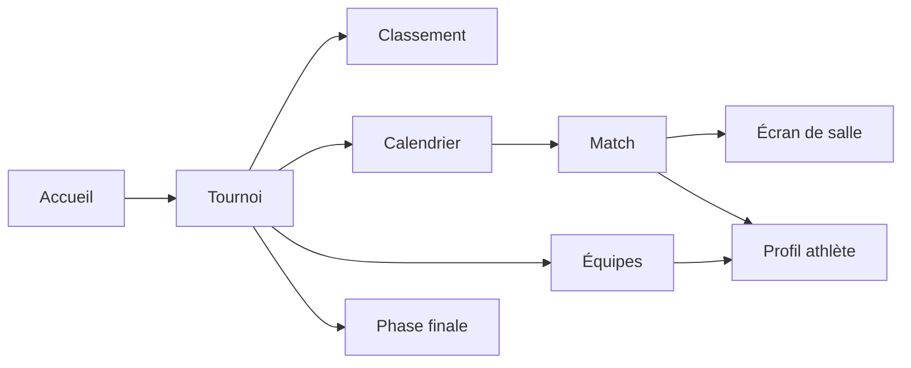

# Spectateur flow

**Acteur** : public, joueur sans compte, parent.
**Compte** : aucun.

## Étapes

1. **Accueil** : liste des tournois publics, recherche par nom.
2. **Page du tournoi** :
   - **Classement** : poule ou phase finale, règles FIBA ;
   - **Calendrier** : matchs passés et à venir, scores ;
   - **Équipes** : effectifs, avec un lien vers le profil de chaque joueur ;
   - **Phase Finale** : tableau des séries ;
   - **MVP** du tournoi.
3. **Page d'un match** : score, stats de chaque joueur, mise à jour pendant le direct.
4. **Écran de salle** `/match/<id>/ecran` : version grand écran.
5. **Profil d'un athlète** `/athlete/<id>` : carrière, tournois, palmarès.

## Règles

- Tout est en lecture seule.
- Aucun email n'est affiché.
- Les liens d'inscription et d'invitation ne sont pas visibles du public.
- Un tournoi privé n'apparaît nulle part : ni dans la liste, ni par son adresse, ni sur les profils des joueurs.
- Un tournoi clôturé reste consultable.
- Un match perdu par forfait affiche « Forfait », sans feuille de stats.
